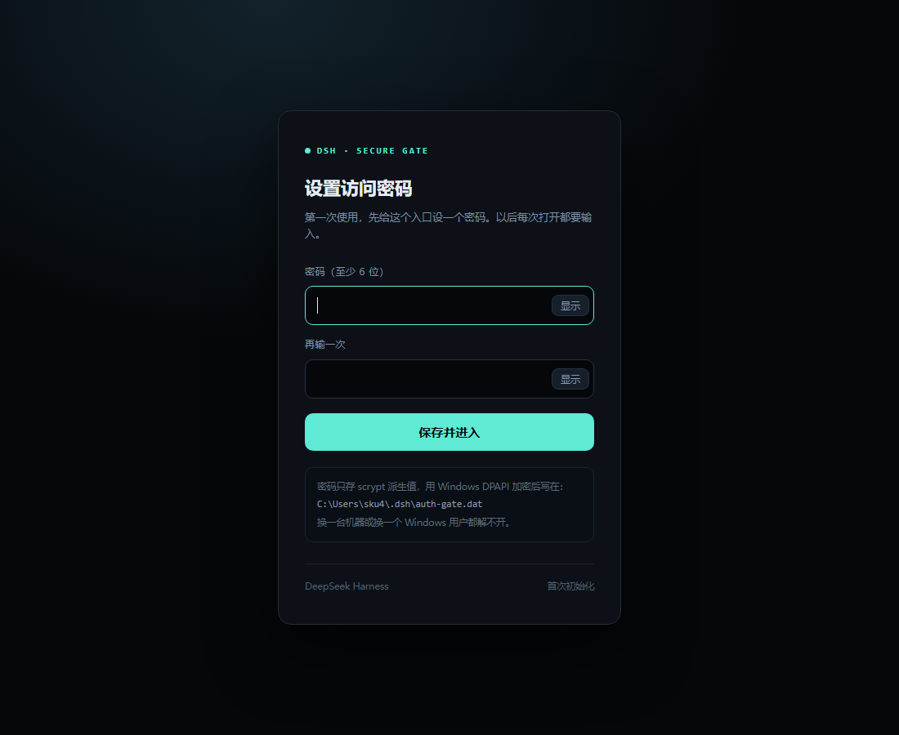
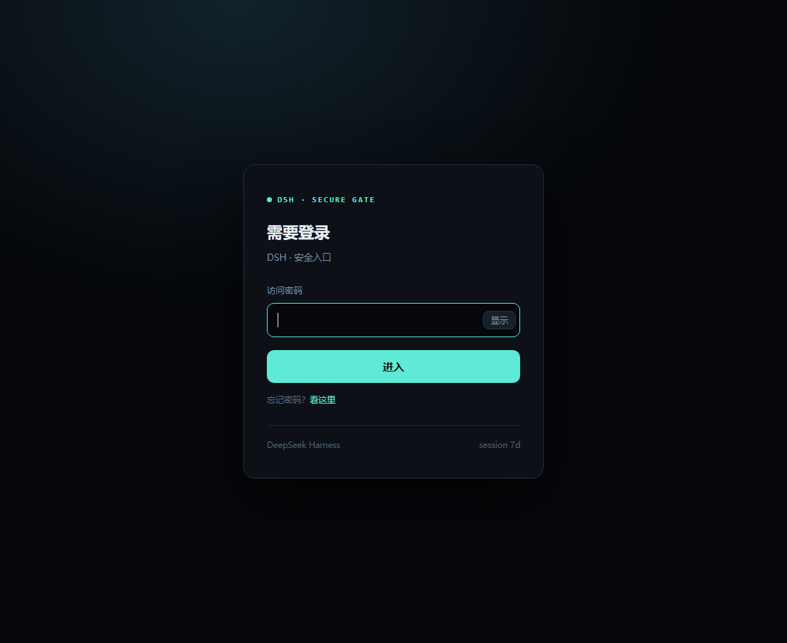
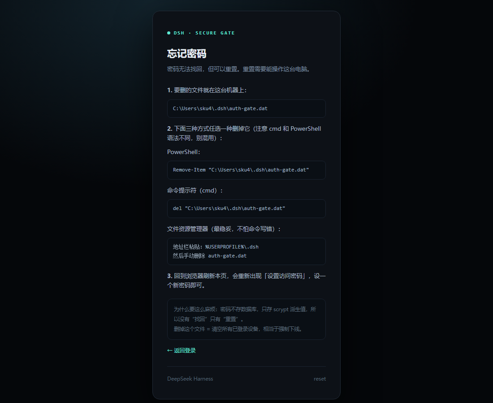

# dsh-login-gate

给 [DeepSeek Harness](https://github.com/deepseek-ai/deepseek-harness) 的网页入口加一道密码。

装好之后：**打开 DSH 先看到登录页，输对密码才进得去。**

> DSH 自带的是进程级 launch token（`?token=xxx`），拿到 URL 的人就能进。
> 这个插件补上「人」这一层：密码、会话、限流、遗忘重置。



---

## 特性

| | |
|---|---|
| 首次访问引导 | 没设过密码 → 自动进入「设置密码」页，不用命令行 |
| 密码可见 | 输入框右侧「显示」，临时看一眼确认没打错 |
| 会话 | 默认 7 天，HttpOnly + SameSite=Lax，HTTPS 下自动 Secure |
| 防爆破 | 每 IP 连续 5 次失败锁 10 分钟（识别 `CF-Connecting-IP`） |
| 忘记密码 | 登录页入口 + 三步重置说明（PowerShell / cmd / 资源管理器） |
| 安全存储 | 密码不落明文：scrypt 派生 + Windows DPAPI 加密 |
| 初始化保护 | 第一次设密码只允许本机，防止公网被抢注 |

---

## 安装

需要 **Windows**（DPAPI）和 **Node 20+**。

```powershell
# 1. 把插件装进 web profile
dsh plugin --profile web add file:C:\path\to\dsh-login-gate

# 2. 让 bundle 生效
#    编辑 %USERPROFILE%\.dsh\profiles\web\package.json
#    在 dsh.profile.bundles 里追加一行
```

改完长这样：

```json
{
  "dsh": {
    "profile": {
      "bundles": [
        "@deepseek-ai/dsh-base",
        "@deepseek-ai/dsh-web-app",
        "dsh-login-gate"
      ]
    }
  }
}
```

**重启 DSH**，打开 `http://127.0.0.1:3080`，会看到设置页。

> 从 GitHub 安装也可以：
> ```powershell
> dsh plugin --profile web add github:duwenlong2/dsh-login-gate
> ```

---

## 首次使用：设置密码

1. 打开 `http://127.0.0.1:3080`
2. 自动跳到「设置访问密码」
3. 输入两次（右侧「显示」可核对）
4. 点「保存并进入」→ **自动登录**，直接进入 Harness



> 初始化只允许本机（loopback 且无转发头）。
> 从公网访问会提示「只能在本机初始化」。

---

## 日常使用

| 场景 | 行为 |
|---|---|
| 打开 DSH | 已登录直接进；未登录跳登录页 |
| 登录一次 | 7 天内免输 |
| 换设备 / 清 cookie | 重新输一次 |
| 连续输错 5 次 | 锁 10 分钟 |
| 主动退出 | 访问 `/__auth/logout` |

---

## 忘记密码

密码找不回，但可以重置。登录页底部 →「忘记密码？看这里」：



三种方式任选（**cmd 和 PowerShell 语法不同，别混用**）：

**文件资源管理器（最稳）**

```
地址栏粘贴：%USERPROFILE%\.dsh
删除 auth-gate.dat
```

**命令提示符（cmd）**

```cmd
del "%USERPROFILE%\.dsh\auth-gate.dat"
```

**PowerShell**

```powershell
Remove-Item "$env:USERPROFILE\.dsh\auth-gate.dat"
```

删完**刷新浏览器**，会重新出现设置页。**不用重启 DSH。**

---

## 卸载

```powershell
# 1. 从 package.json 的 dsh.profile.bundles 里删掉 "dsh-login-gate"
# 2. 重启 DSH
# 3. 可选：删掉密码文件
Remove-Item "$env:USERPROFILE\.dsh\auth-gate.dat" -ErrorAction SilentlyContinue
```

---

## 配置

`cordis.patch.yml` 里：

```yaml
- id: auth-gate
  name: 'dsh-login-gate'
  config:
    allowLocal: false    # true = 本机免登录，只挡外网
    sessionDays: 7       # 会话有效期（天）
    maxFails: 5          # 连续失败次数
    lockMinutes: 10      # 锁定时长（分钟）
    title: 'DSH · 安全入口'
```

改完重启 DSH 生效。

---

## 密码存在哪

```
%USERPROFILE%\.dsh\auth-gate.dat
```

里面是 **DPAPI 加密** 的 JSON：

```json
{
  "v": 1,
  "hash": "<scrypt 派生值>",
  "salt": "<随机 16 字节>",
  "secret": "<会话 HMAC 密钥>"
}
```

- 没有明文密码
- DPAPI 绑定当前 Windows 用户，拷到别的机器/账户解不开
- 删掉文件 = 清空所有设备会话

---

## 工作原理（一句话版）

DSH 的 HTTP 服务没有全局中间件，只有四张路由表（`exact` / `prefixes` / `upgrades` / `fallback`）。
插件在激活时**把每个 handler 包一层**，请求进来先过门禁，通过后补上 DSH 自己的 cookie 和 Host，再交给原 handler。

```
浏览器 → [dsh-login-gate] → DSH
            ├─ /__auth/*  自己处理
            ├─ 未登录     302 登录页 / 401
            └─ 已登录     注入 cookie + 重写 Host → 原 handler
```

细节见 [docs/DESIGN.md](docs/DESIGN.md)。

---

## 兼容性与边界

- 实测版本：`@deepseek-ai/dsh-* 0.2.1-rc.2`（llama.cpp / web profile）
- 依赖 `webServer` 服务的 `exact` / `prefixes` / `upgrades` / `fallback` 字段；
  DSH 若改名，门禁会**静默失效**（不崩，但不拦），升级后请重跑测试。
- 依赖 `~/.dsh/.credentials.yaml` 的 `browser-session` secret 代签 cookie。
- 限流是进程内内存，重启清零。
- 安装后需要重启 DSH 才生效。

---

## 相关项目

- [TecFancy/dsh-auth-gate](https://github.com/TecFancy/dsh-auth-gate) —— 先出现的同名插件（已发布 npm）。
  功能更全：TOTP 双因素、共享令牌登录、用户管理 CLI。

本项目的取舍不同：**不引入第二因素**，专注"暴露到公网要有一道密码"这一件事，
并把**首次设置、忘记密码**做成网页闭环（不需要命令行），密码用 scrypt + Windows DPAPI 存储。

---

## 开发

```powershell
# 24 项隔离测试（mock webServer + 真实 HTTP）
npm test

# 三个页面的本地预览（端口 3095）
npm run preview
```

测试覆盖：首次初始化 → 设置 → 自动登录 → 未登录跳转 → API 401 →
忘记密码页（PowerShell/cmd/绝对路径/资源管理器）→ 密码校验 → 伪造 cookie → 限流。

---

## 目录

```
dsh-login-gate/
├─ index.js          cordis 插件：包装路由表
├─ gate.js           门禁核心：会话 / 密码 / 页面 / 限流
├─ dpapi.js          Windows DPAPI 封装
├─ setup.mjs         命令行设密码（批量部署用）
├─ cordis.patch.yml  bundle 清单 + 默认配置
├─ test/
│  ├─ harness.mjs    24 项测试
│  └─ preview.mjs    页面预览
└─ docs/
   ├─ DESIGN.md      实现与取舍
   └─ images/        截图
```

---

---

## 交流群

QQ 群：**1011056058**（DSH 养成计划 · 小白交流群）

一起把 DeepSeek Harness 用起来：装环境、配本地模型、搭自己的工作台。
不卖课，只聊能跑起来的东西。

---

## License

MIT © 杜文龙
